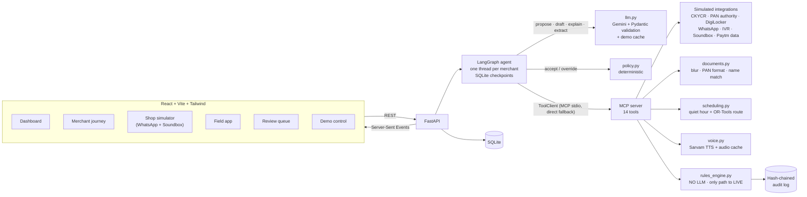
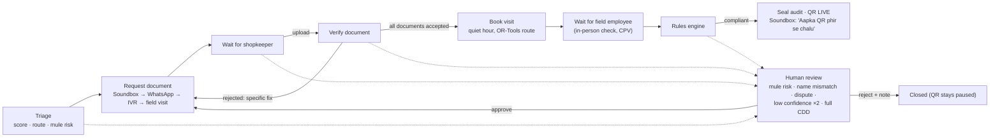

# QR Wapsi

**An AI teammate that gets paused merchants' QR codes working again, one compliant re-KYC at a time.**
RBI's Payment Aggregator Directions (Sept 2025) require aggregators to bring every merchant onboarded till 31 Dec 2025
up to new due-diligence norms. The bottleneck for small merchants is not paperwork but people: someone has to chase
the shopkeeper for a PAN and an ID, check them, and visit the shop in person. QR Wapsi ranks the paused backlog by value
at risk, talks to the shopkeeper in Hindi over WhatsApp and the Soundbox, checks documents and asks for specific fixes,
books the field visit in the shop's quiet hour on an optimised route, and switches the QR back on only when a
deterministic rules engine confirms every requirement — with a sealed, hash-chained audit trail. The LLM proposes and
writes; it never decides compliance, and the in-person check is never skipped.

Paytm Build for India AI Hackathon (Delhi), Track 3: Autonomous AI Teammates · **Team Hawks** (Mayank Bhatt,
Bhumika Bhatt, Tanuja Kanswal).

> **Prototype · synthetic data · integrations simulated.** No real people, PAN numbers or payment data. The specimen
> documents are generated and watermarked "SPECIMEN — DEMO ONLY". Full spec: [CLAUDE.md](CLAUDE.md).
> Finale talk track and judge Q&A: [DEMO_SCRIPT.md](DEMO_SCRIPT.md).

## Architecture



A merchant's journey (the LangGraph graph):



**Guardrails, in code and in tests** (`backend/tests/test_guardrails.py`):
- Only `tools/compliance.py::reactivate_qr` can set a QR to LIVE, and it re-runs `rules_engine.evaluate()` first.
- The rules engine and the reactivation tool cannot import the LLM module, even indirectly.
- At every decision the LLM may only choose among the actions valid in that state (schema-enforced). `policy.py`
  accepts or overrides it, and decides alone if the LLM is unavailable; both are written to the audit log.
- `CPV_DONE` is satisfied only by a visit a field employee completed (geo-tag at the shop, signboard photo,
  confirmation, recorded as `human:<id>`).
- Escalated cases wait for a human; the agent never approves them.

## How to run

Requirements: Python 3.11+, Node 20+, and a bash shell (Git Bash on Windows) for `run.sh`.

```bash
cp .env.example .env      # run.sh does this if .env is missing
./run.sh                  # creates the venv, installs everything, starts backend :8000 and frontend :5173
```
Open http://localhost:5173. **For the finale, set `DEMO_MODE=replay` in `.env`**: it needs no network.

Manual start:
```bash
cd backend && python -m venv venv && . venv/bin/activate      # Windows Git Bash: . venv/Scripts/activate
pip install -r requirements.txt
python scripts/seed.py                                        # rebuild the database (also: Reset on /demo)
uvicorn app.main:app --port 8000
cd ../frontend && npm install && npm run dev
```

Tests: `cd backend && pytest` (rules engine, audit chain, scoring, quiet hour, routing, documents, LLM layer, voice,
MCP transport, agent behaviour, end-to-end journey, offline mode, guardrails). The whole suite runs with the API
keys blank and the network blocked.

## DEMO_MODE

| Mode | Gemini / Sarvam | Cache |
|---|---|---|
| `live` | called | not written (live voice clips go to `backend/data/audio/`) |
| `record` | called | every response saved to `backend/demo_cache/` |
| `replay` | **never called** | served from `backend/demo_cache/`; a miss is logged loudly and the deterministic fallback is used (policy decides, template message, browser voice) |

In replay mode an **offline guard** blocks every non-loopback connection in the API and in the MCP tool process,
and logs any attempt, so the finale runs with Wi-Fi off.

Fill the cache (needs both API keys and a network):
```bash
cd backend
python scripts/warm_cache.py --prune   # record mode: reset, run the finale + escalation demo, replay it offline,
                                       # print every cached key, delete stale ones; must end "RESULT: OK"
python scripts/warm_cache.py --check   # no network: list what is cached
```
Re-run it after any change to a prompt, a message or an agent step.

Other settings in `.env`: `GEMINI_MODEL` / `GEMINI_FALLBACK_MODEL`, `TOOL_TRANSPORT` (`mcp` default, `direct`
fallback; `/api/system` shows which is active), `SIM_LATENCY_MS` (artificial latency of each mocked call, default 80).

## What's real and what's simulated

| Real (runs in the prototype) | Simulated |
|---|---|
| LangGraph agent with per-merchant checkpoints (resumes after a restart) | 1,000 merchants, payment histograms and risk signals (synthetic, fixed seed) |
| Gemini calls: ranking explanation, Hindi messages, next-action proposals, document field extraction | CKYCR lookup, PAN verification with the issuing authority, DigiLocker (mock clients with real-looking interfaces) |
| Sarvam Hindi TTS for the Soundbox (cached clips) | WhatsApp, IVR and the Soundbox device (screens in the browser) |
| MCP server and client (stdio) for all 14 tools | The shopkeeper and the field employee (people clicking the simulator and field app) |
| Deterministic rules engine and hash-chained, append-only audit log | GPS fix (placed at the shop), signboard and document photos (generated specimens) |
| Priority and mule-risk scoring, quiet-hour finder, OR-Tools day routing | The QR standee (illustrative, not scannable) and a simulated clock for retries |
| Document checks: blur (Laplacian variance), PAN format, fuzzy name match | Form 60 "recorded with the authority" |
| Retry ladder, escalation, human review, live UI over SSE | |

## The 5-step finale (≈ 3 minutes)

Reset on `/demo`, then use the **Demo script** panel there: each step's button opens the right page in a new tab.

1. **Dashboard:** 1,000 paused merchants. The agent ranks **Sharma Kirana Store** first and the LLM explains why.
   Click *Start agent journey*.
2. **Shop simulator:** a Hindi WhatsApp message and a Hindi Soundbox prompt. Send the **blurry PAN** → rejected with
   a specific fix ("photo is blurry, retake in good light") → send the **clear PAN** → accepted → send the **ID document**.
3. **Merchant journey:** the agent books **3:10 PM**, the shop's quietest hour, as stop 4 of Neha Tyagi's OR-Tools route.
4. **Field app:** open the 3:10 PM visit → capture location → signboard photo → confirm → submit.
5. **QR live:** every requirement passes in the rules engine, the audit record is sealed, the QR flips **Paused →
   Live** and the Soundbox says **"Aapka QR phir se chalu"**.

Escalation path (optional): *Trigger a risky merchant* on `/demo` → the case appears in `/review` with its risk
evidence → approve (the journey continues) or reject with a note (the journey closes). Both are in the audit log.

## Layout
```
backend/app/        FastAPI app: agent/, tools/, integrations/, routers/, llm.py, voice.py, rules_engine.py,
                    rules_config.yaml, audit.py, scoring.py, scheduling.py, documents.py, mcp_server.py, netguard.py
backend/scripts/    seed.py, make_specimens.py, warm_cache.py
backend/demo_cache/ recorded LLM answers and Soundbox clips (commit this: replay mode needs it)
backend/tests/      pytest suite
frontend/src/       pages/ (6 screens), components/, lib/ (API client, live events)
```
